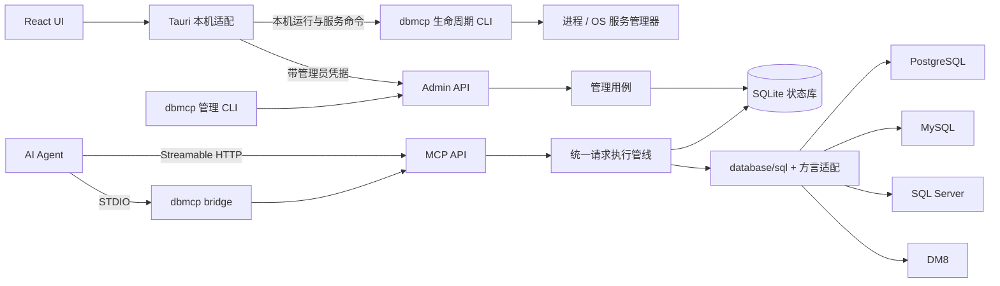

# 架构、状态与接口设计

本文件描述 Server / MCP / CLI 与桌面管理的架构；驱动与语法限制见 [依赖说明](dependencies.md)。

## 1. 总体结构



一个 Go 可执行文件包含 `serve`、管理 CLI、`bridge`、`service` 和后台运行命令；Bridge 只是另一个进程入口，不是第二个数据库执行器。Server 关闭时 Bridge 返回可理解的连接错误，不自行偷偷启动另一个带独立状态的 Server。

MCP 和 Admin 使用不同监听器、认证中间件及路由。MCP 凭据不能调用管理端；管理员操作不注册为 MCP 工具。两者共享内部用例和状态库，不共享外部权限。

## 2. 目标目录与依赖方向

```text
db-mcp-tools/
├── client/
│   ├── src/
│   │   ├── components/ui/       shadcn 基础组件
│   │   ├── features/            instances / entities / approvals / logs / settings
│   │   ├── lib/                 API、Query keys、共享类型
│   │   └── styles/              主题变量
│   └── src-tauri/
│       ├── src/                 窗口、Admin 通信、凭据、文件与进程适配
│       ├── capabilities/        最小桌面能力配置
│       ├── binaries/            构建时暂存 Server，不提交二进制
│       └── tauri*.conf.json     基础和携带 Server 的覆盖配置
├── server/
│   ├── cmd/dbmcp/               命令入口
│   ├── internal/
│   │   ├── app/                启动装配与统一执行管线
│   │   ├── instance/           实例与模板
│   │   ├── entity/             实体、凭据、绑定
│   │   ├── access/             策略合成与来源检查
│   │   ├── sqlguard/           AST 到统一语句信息，字段引用与 SQL 分类
│   │   ├── approval/           审批状态、单次许可和持久规则
│   │   ├── mask/               列和内容规则，结构化结果处理
│   │   ├── audit/              日志查询与保留
│   │   ├── database/           执行、Schema、各方言驱动与 PG 扩展
│   │   ├── storage/            SQLite 与迁移
│   │   ├── adminapi/           管理 HTTP API
│   │   ├── mcp/                MCP 工具与传输适配
│   │   └── runtime/            后台进程及 service 库封装
│   ├── migrations/             SQLite SQL 迁移，go:embed
│   └── tests/integration/      一组可复用的四数据库集成场景
├── docs/
└── scripts/                    必要的跨平台构建和检查入口
```

这是职责地图，不要求提前创建全部目录。模块出现真实代码时再拆文件；不为每个结构机械创建 repository、service、manager 三层。

依赖方向：协议适配 → 管理或执行用例 → 策略 / 审批 / Mask / 数据库接口；SQLite 提供持久化。`mask` 不认识 MCP，`database` 不处理实体和审批，`approval` 不直接执行 SQL。Rust 不打开业务 SQLite，也不连接目标数据库。

Admin API 采用 OpenAPI 3.1 文档；前端以 `openapi-typescript` 生成类型，生成的客户端类型不含业务规则。Rust 代理只转发经过白名单限定的管理请求并统一处理认证，不复制一套管理数据模型。

## 3. Server 启动与存储

- `server/go.mod` 初始可用本地 module 名 `dbmcp.local/server`；不依赖尚未指定的 Git 远端。后续确定远端时集中调整模块路径。
- 启动配置使用小型 TOML 文件：监听地址、数据目录、日志、代理信任、TLS 路径等部署设置。实例和策略保存在 SQLite，避免两套配置相互覆盖。
- 数据目录包含 `state.sqlite`、部署配置、独立密钥文件、运行标识、轮转运行日志与备份。应用安装目录只放程序，不存业务状态。
- SQLite 启用外键、WAL 和合理的 busy timeout。初期一个状态连接串行短事务即可；审批等待和数据库查询不持有 SQLite 写事务。
- goose 通过嵌入的迁移脚本升级；迁移前一致性备份。不做数据库版本降级，旧程序发现新 schema 给出明确错误。
- 实例连接按实例和目标数据库维护 `sql.DB` 池，执行并发门限仍由同一实例共享；修改连接后关闭该实例的所有数据库池，不为每个数据请求重新建连接。

集中运行诊断使用 Go slog / lumberjack 和 Tauri 官方日志插件，按进程锁定文件并轮转；审计仍在 Server SQLite。管理员诊断接口只汇总日志、安全状态及审计摘要，不输出秘密或查询载荷。桌面通过同一管理连接合并远端快照，失败必须显式报告；停机 CLI 只读日志，不打开业务库。关联 ID 贯穿 Rust、Go HTTP 和执行管线。详见 [日志与诊断](diagnostics.md)。

## 4. 数据模型

ID 使用随机 UUID；时间内部统一 UTC，UI 按用户时区显示。初期把结构化策略存为带版本的 JSON，不拆成通用规则引擎的几十张表。

| 表                   | 核心字段和用途                                                                              |
| -------------------- | ------------------------------------------------------------------------------------------- |
| `instance_templates` | 名称、版本、默认策略 JSON；新建实例时复制快照                                               |
| `instances`          | 名称、数据库类型、非敏感连接 JSON、加密密码、启用状态、基础策略 JSON、revision              |
| `entities`           | 稳定 ID、名称、备注、启用状态、首次 / 最近访问、观察到的客户端信息                          |
| `credentials`        | ID、entity_id、随机 Token 摘要、短前缀、到期 / 撤销时间；不保存 Token 明文                  |
| `registrations`      | 每份接入配置的独立凭据摘要、登记状态、关联实体、首次来源和时间；安装时不预建实体            |
| `entity_instances`   | entity_id + instance_id 唯一绑定、允许资源、操作权限、额外限制和管理员显式例外              |
| `approvals`          | request_id、实体 / 凭据 / 实例、加密原始请求、摘要、审批状态、有效期、决策人及策略 revision |
| `requests`           | entity_id + client_request_id 唯一、请求摘要、执行状态、审批关联、受限结果或错误引用        |
| `audit_events`       | 时间、实体 / 实例 / request_id、动作、决策、耗时与不含查询载荷的摘要                        |
| `request_details`    | 管理员只读的加密 SQL／参数快照、执行摘要、匹配规则引用；保留 30 天，与执行／重试载荷分离    |
| `settings`           | 默认模板、审计保留、备份设置等少量全局配置                                                  |

Mask 规则属于实例策略或绑定策略，包含规则 ID、字段目标或名称模式、处理方式、参数和显式顺序；不再建一套独立策略注册中心。常见筛选列建立必要索引即可。

实例删除使用停用 / 归档语义保留审计引用；实体快速禁用与删除历史分开。默认审计保留 30 天；过期审批的原始 SQL / 参数载荷及时清理，只保留决策摘要。短期请求结果缓存单独限额，不把敏感结果长期变成日志。

### 凭据与秘密

实体 Token 使用加密安全随机数生成，服务端存 SHA-256 摘要，明文只在签发时交给配置安装流程。高熵随机 Token 不需要密码哈希框架。Entity ID 与 Credential ID 分离，轮换不丢历史。

管理员凭据单独生成和撤销。桌面端用 OS keyring 保存，Rust `reqwest` 带上认证后转发 Admin 请求，WebView 不持久保存管理员 Token。CLI 使用权限受限的凭据文件或显式传入的环境变量。

接入配置安装只由 Admin 签发独立随机接入凭据，首次 MCP 请求原子创建停用实体与凭据记录并进入待授权状态；并发重试共用同一实体。未经准备的未知 Token 仍拒绝，不提供匿名注册或发现。实体识别绑定凭据摘要，不依赖 Agent 自报名称或 IP。管理员在独立的实体登记审批中确认绑定策略，所有绑定和实体启用在一个事务提交；批准后原凭据继续有效。认证和执行前重检都会检查登记状态，不能通过其他实体编辑或新签发凭据绕过待授权状态。拒绝或移除会撤销接入凭据并停用关联实体。

SQLite schema 2 新增登记表。打开 schema 1 状态前先生成一致性快照，再迁移；备份清单记录实际 schema，当前程序可校验和恢复 schema 1 / 2，旧程序拒绝较新状态。登记凭据只保存摘要，不进入配置导出。

1.0.1 使用 schema 3。连接中的 `database_mode` 为 `single`、`selected` 或 `all`；缺省仍为旧单库，`databases` 保存部分库的精确名称，`database` 在单库模式表示目标库，在全部模式可指定初始连接库。全部模式按当前账号可访问的数据库动态发现，不把保存时的列表固化。PG 使用 pg_database，MySQL 使用 SHOW DATABASES，SQL Server 使用 sys.databases；DM8 使用 V$DATABASE，单端口仍只有一个数据库，用户 / Schema 是库内范围。

MCP 增加 `list_databases`；Schema、查询、执行、Explain 与模拟器携带 `database`。多库实例须明确目标，只有单库或部分列表恰好一项时可省略，DM8 还可推断端点的唯一实际库。SQL 分析、连接池与执行使用同一目标，禁止 USE 和跨库 SQL；MySQL 的库名前缀按精确名称核对。实例与绑定继续取交集，强制 Mask 保持同一出口。

请求载荷、请求摘要、审批展示和记住的规则均包含数据库；恢复时重新检查目标仍在当前范围内。schema 3 迁移前生成备份，将旧请求和旧审批规则固定到原单库；旧待处理请求若实例版本已变化而无法确认原目标则取消，不能静默转到另一个库。可恢复 schema 1 / 2 / 3 的配套备份；旧程序拒绝 schema 3，降级须恢复旧备份。

1.0.2 使用 schema 4，新增数据库限定资源键 `db/<encoded-database>/<encoded-schema>.<encoded-table>[.<encoded-column>]`；整库和模式分别为 `db/<库>/*`、`db/<库>/<模式>.*`。名称沿用 Resource 保留字符编码；授权匹配保持大小写敏感。旧相对规则保留语义。数据库发现、目录过滤、SQL 分析后的表／列检查与执行前重检均调用同一 Policy 方法，不能仅凭连接范围跳过资源约束，常量 SELECT 也须通过数据库权限检查。迁移前备份；旧 selected 配置未填写默认库时固定为其首个已选库以保留发现入口，不改变旧资源范围。旧程序拒绝 schema 4，降级须恢复升级前备份。

GUI 的连接页只编辑默认连接目标，范围页从资源键派生 selected / all 连接范围，空授权使用 all 加空资源保持拒绝。Admin 的 POST `instances/databases` 与 `instances/schema` 可读取未保存的连接；后者使用隔离 Manager 和短连接池，复用已保存密码但不回传密码，不与正式实例池混用。管理员可查看连接账号可见对象以选择授权；实体授权界面使用已保存实例的 GET 接口，只能查看实例上限内的对象。Catalog 返回 database、schemas（包含空模式）、columns、extensions。PG / SQL Server 展示库 → 模式 → 表 → 列，MySQL 合并库和模式，DM8 展示端点实际库和用户／模式。

数据库密码、待审批原始 SQL / 参数及需要缓存的结果用 Go 标准库 AES-GCM 加密，密钥放在同数据目录的独立受限文件；不自造密码算法。该设计解决明文状态与备份泄露，不能抵抗已经控制同一账户和密钥文件的人。系统服务通过其服务账户读取对应密钥，不依赖桌面 keyring 登录态。

## 5. 唯一数据库执行入口

### 数据库适配约定

统一使用 `database/sql`，只保留连接、Schema、SQL 分析和能力查询几个小接口，不强迫每种数据库实现全部扩展。

| 数据库     | 驱动与参数                                | 主要差异                                                             |
| ---------- | ----------------------------------------- | -------------------------------------------------------------------- |
| PostgreSQL | pgx/v5 stdlib，`$1`                       | database / schema、只读事务、扩展发现、数组 / JSON / 空间值          |
| MySQL      | go-sql-driver/mysql，`?`                  | database 与 schema 同义、反引号、会话只读、字节切片与日期            |
| SQL Server | Microsoft go-mssqldb，`@p1` / `sql.Named` | catalog / schema、方括号、TOP / OUTPUT、decimal 与日期类型           |
| DM8        | 官方原生 `dm`，`:1` / 命名参数            | 用户 / schema 和大小写、系统元数据、DmClob / DmBlob、Oracle 兼容子集 |

DM 使用可选的原生 Go 模块，ODBC 不是运行依赖。驱动按实际许可使用固定模块版本接入，不向 GOROOT 复制代码。数据库密码用各驱动的 DSN / 配置构造接口编码，不手工拼接导致特殊字符失效。

能力至少区分 Schema 发现、只读会话 / 事务、取消执行、非执行 Explain 和 PG 扩展；以实际引擎与驱动测试结果设置。某项能力缺失应明确反馈，不静默降级成安全性不同的执行方式。

### 执行顺序

所有数据库工具、审批恢复和规则模拟共用 `app` 的一个执行管线；UI 不判断 SQL 是否安全。

1. **认证和路由**：校验实体与凭据状态，只暴露已绑定实例；来源从真实连接获取，只有配置了可信代理才读取转发头。
2. **快照策略**：加载实例和实体绑定，检查启用状态、IP/CIDR、资源与操作范围，生成当前有效策略和 revision。
3. **SQL 分析**：选方言 Parser，得到单条语句类型、资源和字段引用、输出来源、危险特征。多语句、无法支持的过程 / 动态 SQL、解析失败直接返回明确错误。
4. **授权和审批决策**：先处理硬拒绝，再决定放行或创建审批。等待期间不连接目标数据库，不预先开启事务。
5. **执行前重检**：审批完成或恢复时核对原始请求、凭据、策略和有效期，认领执行状态，设置并发和执行 deadline。
6. **数据库执行**：使用绑定参数与 `database/sql`；按能力使用只读事务 / 会话，写操作在本请求内事务提交或回滚。普通 SELECT 不放行任意具有副作用的函数，UDF / 过程先不支持。
7. **统一输出**：规范化驱动值 → 列权限确认 → Mask（含用户配置的正则替换） → 行数和编码后字节限额 → 结构化 MCP 结果；同时生成安全的文本表示。
8. **请求及审计落库**：记录决策、耗时、命中规则、截断信息及安全错误；参数、原始结果和秘密不写运行日志。

写操作的 `RETURNING` / `OUTPUT` 结果也走相同出口。`db_query` 只接受查询，`db_execute` 接受已授权 DML；不能通过换工具名称绕过管线。Schema 工具先过滤资源可见性，禁止字段默认也不向实体展示；Describe 不返回样本值。

字节上限在结果构建时执行，不先把全部结果载入内存再截断。达到限制关闭 rows，返回 `truncated=true` 和原因。执行超时 15 秒不包含人工审批时间。

### SQL 与列来源的实际范围

优先复用 Omni AST，并用很薄的方言适配器产生统一 `StatementInfo`。先覆盖单条 SELECT / INSERT / UPDATE / DELETE、常用 JOIN、CTE、子查询、投影别名与 `*`；不承诺所有语法都支持。Parser 有 AST 不代表已完成资源解析或授权。

字段解析结合当前 Schema，检查 SELECT、WHERE、JOIN、ORDER BY、GROUP BY 等所有读取位置，以及 UPDATE / INSERT 的目标和表达式。`*` 需先展开，不能靠返回列名猜原字段；T-SQL 三段名、大小写和引用规则由方言处理。

输出记录来源字段集合及其是否确定。简单别名沿用源字段规则；敏感字段参与的派生表达式默认整值替换，避免将原规则套到不同类型的结果。受限制资源的来源无法确定时拒绝，建议改查已授权安全视图。DM8 仅采用经过真实样本确认的 Oracle 兼容子集，专有语法按能力提示不支持。

只读与禁止列还需数据库最小权限账号 / 安全视图配合；不承诺靠 SQL AST 建立完整数据库沙箱。Explain 默认只生成计划，不使用执行语句的 ANALYZE 模式，计划输出同样经过受限信息处理；无法保证安全处理的方言不开放该工具。

### 策略与 Mask 合成

- 有效资源 / 操作权限取实例基线与实体绑定的交集；IP 限制同时满足；数值限额取较小值；实体额外审批取更严格模式。
- 硬拒绝优先。实例强制 Mask 不接受 Agent 参数关闭；实体普通配置只能增加处理。
- 先执行实例字段规则，再执行实体额外规则，不额外执行内置内容检测。每组按保存的显式顺序确定结果；禁止访问在执行前生效，不作为返回 NULL 的策略。
- “部分保留”“正则替换”之间不存在通用的严格程度排序，不编造自动比较算法。UI 展示实际处理顺序和预览，阻止同一目标的歧义配置。
- 如确有查看原值需求，管理员为绑定创建明确例外，指明允许跳过的规则 ID 和范围并审计；实例默认不允许创建这种例外。

## 6. 审批与重复执行

```text
pending -> approved -> executing -> succeeded / failed / result_unknown
        -> denied
        -> expired
        -> cancelled
```

创建待审批记录时固定 Entity ID、Credential ID、实例、操作、SQL、参数及摘要和过期时间；原始请求载荷加密存储。相同 `client_request_id` 携带不同内容返回冲突，不能复用批准结果执行另一个请求。

“允许一次”只改变本请求的审批状态，不直接在审批 HTTP handler 里执行 SQL。“记住规则”明确展示实例、表和操作范围，经管理员保存绑定策略后重新计算本请求；不把一个 SQL 文本简单变成宽泛正则授权。审批不能解除硬拒绝。

Bridge 可在客户端调用超时允许的范围内等待状态；等待结束返回 `approval_required`、request_id、有效期和恢复工具说明。普通 HTTP 客户端使用 `approval_status` / `resume_request`，授权结果只给原实体且要求原凭据仍有效。每次真正执行前重新检查权限；SQL / 参数变化必须新建请求。

用 SQLite 条件更新认领 `approved -> executing`，并发 resume 只能有一个执行者。进程若在目标库提交后、写回本地状态前退出，跨两库无法保证“恰好一次”：此类写入重启后标为 `result_unknown`，不自动重试，提示管理员检查目标库。重复请求返回已有结果或状态，不盲目再次执行。

Server 重启后恢复 pending；过期置 expired；中断的只读请求可由客户端重新发起。禁用实体或撤销原凭据使相关待执行请求失效。UI 事件流断开不影响已持久化的审批。

## 7. 管理 API、MCP 与 CLI

Admin API 以 `/admin/v1` 为前缀，分页使用统一 cursor；常见状态使用稳定错误码和说明，不把驱动错误原样返回给 Agent。更新实例和策略携带 revision，过期编辑返回冲突提示重新加载。

| 管理资源                                | 主要操作                                                                         |
| --------------------------------------- | -------------------------------------------------------------------------------- |
| `health` / `version`                    | 连通性、server_id、API 主版本、应用版本、驱动能力；未认证健康检查只给最小状态    |
| `instances` / `templates`               | CRUD、复制模板、测试连接、Schema、有效策略、规则模拟、Mask 预览                  |
| `entities` / `credentials` / `bindings` | 登记、签发 / 轮换 / 撤销、禁用、实例授权                                         |
| `approvals`                             | 列表、详情、approve-once、deny、保存限定规则；决策原子更新                       |
| `audit-events`                          | 过滤、分页；按事件 ID 查询请求详情与关联事件，单次请求导出包含已保存的 SQL／参数 |
| `settings` / `backups`                  | 设置、配置导出 / 导入、一致性快照、受控恢复                                      |
| `events`                                | SSE，审批和状态变化事件；断线后重新读取列表，不建立复杂事件总线                  |

UI 通过 Tauri Rust 代理管理请求和 SSE，并以 Tauri 事件更新 TanStack Query 缓存。协议不匹配时展示升级说明，不静默尝试各种历史 API。

MCP 工具按产品能力集中注册：

| 工具                                              | 行为                                               |
| ------------------------------------------------- | -------------------------------------------------- |
| `list_instances`                                  | 只返回实体有权限的实例                             |
| `list_schemas` / `list_tables` / `describe_table` | 按有效资源权限过滤的 Schema 发现                   |
| `db_query` / `db_execute`                         | 实例、SQL、参数、client_request_id；分别查询与 DML |
| `db_explain`                                      | PostgreSQL 非执行计划                              |
| `approval_status` / `resume_request`              | 查看与恢复原请求，不接受另一份 SQL 替换            |

只保留一套 CLI 命令：`dbmcp serve`、`run start|stop|restart|status`、`service install|uninstall|start|stop|restart|status`、`instances`、`entities`、`approvals`、`backup`、`restore`、`bridge`。管理业务命令调用 Admin API；进程和服务命令操作本机；离线恢复单独要求 Server 已停止。

## 8. 备份与网络部署

配置导出是带版本的 JSON，默认不包含密码、Token、待审批请求、结果缓存和审计原文；导入展示计划并在一个 SQLite 事务中应用，Token 重新签发。完整状态备份通过 SQLite 一致性快照完成，不只复制在线 `state.sqlite` 而漏掉 WAL。

完整恢复停机执行，先备份现状，再检查版本和完整性；密钥文件与状态快照配套保管，默认配置导出不带密钥。定期备份由 Server 内的简单定时任务执行，初始建议每天一次、保留最近 7 份，不引入调度服务。

远程 MCP 明确配置监听与 CIDR，并使用 TLS 或用户已有反向代理。Admin 保持回环监听，远端桌面通过现有 SSH 隧道连接；纯客户端模式不因为远端连接而获得远端 OS 服务控制。V1 不增加 OAuth 服务器、网络发现或远程执行代理。
