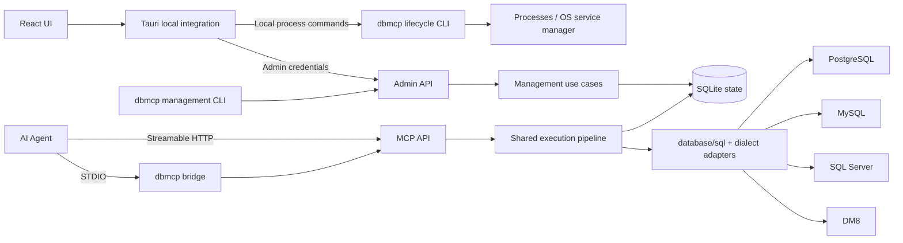

# Architecture, state, and APIs

This document describes the MCP Server, MCP transport, CLI, and desktop management architecture. See [Dependencies and limitations](dependencies.md) for drivers and SQL restrictions.

## 1. Overview



One Go executable contains `serve`, the management CLI, `bridge`, `service`, and background process commands. The Bridge is another process entry point, not another database executor. If the MCP Server is stopped, it returns a connection error rather than silently starting a separate MCP Server with independent state.

MCP and Admin use separate listeners, authentication middleware, and routes. MCP credentials cannot call management APIs; administrator operations are not MCP tools. Both share internal use cases and state, not external permissions.

## Desktop sessions and profiles

Rust owns the single active profile, session generation, in-memory credentials, connection state, and local process identity. The profile list, active ID, and per-profile preferences are atomically saved in `profiles.json`. Administrator credentials are stored by profile ID in the OS keyring. Business state and SQLite belong only to Go.

Switching and lifecycle changes use a mutually exclusive entry point; ordinary management requests hold read permits. Switching is rejected during active operations. Each business IPC request carries a profile ID and session generation, which Rust validates before capturing the target and credential. Switching increments the generation, cancels SSE, and makes the frontend discard stale responses, query caches, and notifications. Connected state is set only after success. Failures stay disconnected and never replay writes.

Go `runtime info` supplies local metadata; Rust does not open SQLite. When supported, `init --allocate-ports` assigns loopback ports and `runtime prepare` initializes the stable launcher without a backup. Older compatible CLIs retain their existing initialization and start / stop commands. Activating a local configuration starts or attaches to its identity-matched background process without upgrading. Process `instance_id` is checked before stopping when supported; older versions retain credential, server identity, and data directory checks. HTTP configurations never control processes. Tray and lightweight modes do not trigger shutdown. System services are independent CLI deployments, connected through HTTP in the desktop.

## 2. Responsibilities and dependency direction

```text
db-mcp-tools/
├── client/
│   ├── src/
│   │   ├── components/         Shared UI components
│   │   ├── features/           Instances, entities, approvals, logs, settings
│   │   └── lib/                API, query keys, shared types
│   └── src-tauri/
│       ├── src/                Window management, Admin transport, credentials, files, processes
│       ├── capabilities/       Minimal desktop capabilities
│       ├── binaries/           Build-time MCP Server staging; no committed executables
│       └── tauri*.conf.json    Base, development, and packaging configuration
├── server/
│   ├── cmd/dbmcp/              Command entry point
│   ├── internal/
│   │   ├── app/                Assembly and shared execution pipeline
│   │   ├── instance/           Instances and templates
│   │   ├── entity/             Entities, credentials, bindings
│   │   ├── access/             Policy composition and source checks
│   │   ├── sqlguard/           AST analysis, field references, SQL classification
│   │   ├── approval/           Approval state, one-time grants, persistent rules
│   │   ├── mask/               Field / content rules and structured output
│   │   ├── audit/              Audit queries and retention
│   │   ├── database/           Execution, catalogs, dialects, PostgreSQL extensions
│   │   ├── storage/            SQLite and migrations
│   │   ├── adminapi/           Management HTTP API
│   │   ├── mcp/                MCP tools and transport adapters
│   │   └── runtime/            Background processes and service library adapters
│   ├── migrations/            Embedded SQLite migrations
│   └── tests/integration/     Reusable database integration scenarios
├── docs/
└── scripts/                   Cross-platform build and check entry points
```

This is a responsibility map, not a requirement to create every directory in advance. Split modules when real code needs it; do not mechanically add repository / service / manager layers.

Dependencies flow from protocol adapters to management / execution use cases, then policy, approval, Mask, and database interfaces, with SQLite providing persistence. Mask does not know MCP; database adapters do not handle entity approvals; approval does not execute SQL directly. Rust neither opens business SQLite nor connects to target databases.

Admin uses OpenAPI 3.1. The frontend generates types with `openapi-typescript` without adding business rules. Rust forwards allowlisted management requests and authenticates them rather than duplicating management models.

## 3. MCP Server startup and storage

- Go uses the local module name `dbmcp.local/server` without depending on a Git remote.
- A small TOML file stores deployment settings such as listeners, directories, logs, proxy trust, and TLS paths. Instances and policies live in SQLite, avoiding conflicting configuration sources.
- Data directories contain `state.sqlite`, deployment settings, separate key files, runtime identity, rotating logs, and backups. Application installation directories contain executables, not business state.
- SQLite enables foreign keys, WAL, and a reasonable busy timeout. Short transactions are serialized; approval waits and database queries hold no SQLite write transaction.
- goose applies embedded migrations after a consistent snapshot. Schema downgrades are unsupported; old executables explicitly reject newer schemas.
- Each instance maintains `sql.DB` pools per target database while sharing its concurrency limit. Connection changes close all pools for that instance; requests do not create new pools each time.

Go slog / lumberjack and Tauri's log plugin provide per-process locked, rotated diagnostics. Audit remains in SQLite. Administrator diagnostics summarize logs, safe state, and audit without secrets or query payloads. The desktop merges snapshots through its management connection and explicitly reports collection failures. Offline CLI collection reads logs without opening business state. Correlation IDs span Rust, Go HTTP, and execution. See [Diagnostics](diagnostics.md).

## 4. Data model

IDs are random UUIDs. Internal timestamps use UTC and the UI uses the user's timezone. Structured policies are versioned JSON rather than dozens of generic rule-engine tables.

| Table                | Purpose and key fields                                                                                                                       |
| -------------------- | -------------------------------------------------------------------------------------------------------------------------------------------- |
| `instance_templates` | Name, version, and default policy JSON copied when creating instances                                                                        |
| `instances`          | Name, engine, non-secret connection JSON, encrypted password, enabled state, base policy, revision                                           |
| `entities`           | Stable ID, name, notes, enabled state, first / recent access, observed client information                                                    |
| `credentials`        | ID, entity ID, random token digest, short prefix, expiry / revocation; no plaintext token                                                    |
| `registrations`      | Per-installation credential digest, registration state, associated entity, first source / time; no entity created at installation            |
| `entity_instances`   | Unique entity / instance binding, allowed resources and operations, extra restrictions, explicit administrator exceptions                    |
| `approvals`          | Request, entity / credential / instance, encrypted payload, digest, state, expiry, decision maker, policy revision                           |
| `requests`           | Unique entity / client request ID, digest, execution state, approval link, restricted result or error reference                              |
| `audit_events`       | Time, entity / instance / request, action, decision, elapsed time, payload-free summary                                                      |
| `request_details`    | Administrator-only encrypted SQL / parameters, execution summary, rule references; 30-day retention separate from execution / retry payloads |
| `settings`           | Default template, audit retention, and a small set of global settings                                                                        |

Mask rules belong to instance or binding policy and contain rule ID, field target or name pattern, method, parameters, and explicit ordering. There is no independent policy registry. Add indexes only for real filter needs.

Instance removal uses disabling / archiving to retain audit references. Entity disabling is separate from historical deletion. Audit defaults to 30 days. Expired approval SQL / parameter payloads are cleaned up promptly, retaining decision summaries. Short-lived result caches have separate limits and do not become permanent sensitive logs.

### Credentials and secrets

Entity tokens use cryptographically secure randomness and SHA-256 digests at rest. Plaintext is handed to configuration installation only when issued. High-entropy tokens do not need a password hashing framework. Entity and credential IDs are separate so rotation preserves history.

Administrator credentials are independently generated and revoked. The desktop stores them in the OS keyring; Rust `reqwest` authenticates Admin requests. The WebView does not persist administrator tokens. CLI commands use restricted credential files or explicitly supplied configuration variables.

Agent configuration installation issues an independent registration credential through Admin. Its first MCP request atomically creates a disabled entity and credential record pending authorization; concurrent retries share that entity. Unknown tokens remain rejected without anonymous registration or discovery. Identity follows the credential digest, not an agent's self-declared name or IP. Administrator registration approval commits all bindings and activation in one transaction. The original credential remains valid afterward. Authentication and pre-execution rechecks enforce registration state, preventing bypass through entity editing or additional credentials. Denial or removal revokes the access credential and disables its associated entity.

Schema 2 introduced registration records. Opening schema 1 snapshots before migration. Backup manifests record the actual schema; supported old snapshots can be validated and restored, while old executables reject newer schemas. Registration credentials are digest-only and excluded from configuration export.

Version 1.0.1 introduced schema 3 and `database_mode` values `single`, `selected`, and `all`. Missing mode retains legacy single-database behavior. `databases` stores exact selected names; `database` is the single target or optional initial database in all mode. All mode discovers databases visible to the account dynamically: `pg_database` for PostgreSQL, `SHOW DATABASES` for MySQL, `sys.databases` for SQL Server, and `V$DATABASE` for DM8. A DM8 endpoint still exposes one database with users / schemas beneath it.

MCP adds `list_databases`; catalog, query, execution, Explain, and simulation carry `database`. Multi-database instances require an explicit target except when only one is eligible; DM8 may infer its sole database. SQL analysis, pooling, and execution use the same target. USE and cross-database SQL are denied; MySQL database prefixes must match exactly. Instance / binding intersections and mandatory Mask retain the common pipeline.

Payloads, digests, approval displays, and remembered rules include the database. Resumption rechecks current scope. Schema 3 snapshots before migration and binds legacy requests / rules to their original database. Ambiguous old pending requests are cancelled if an instance revision prevents identifying their original target. Backups from schemas 1 / 2 / 3 are supported; downgrading requires restoring an older backup.

Version 1.0.2 introduced schema 4 with database-qualified keys `db/<encoded-database>/<encoded-schema>.<encoded-table>[.<encoded-column>]`. Database and schema grants use `db/<database>/*` and `db/<database>/<schema>.*`. Names use reserved-character encoding and case-sensitive matching. Legacy relative rules retain their meaning. Discovery, catalog filtering, post-analysis table / column checks, and pre-execution rechecks use the same policy methods. Connection scope never bypasses resource checks; even constant SELECT requires database permission. Migration snapshots first and sets a missing default database in old selected mode to its first selected entry without changing grants. Old executables reject schema 4.

The connection tab edits only the default connection target. Scope derives selected / all database mode from resource keys; empty grants use all mode with empty resources to remain denied. Admin POST `instances/databases` and `instances/schema` support unsaved connections. The latter uses an isolated manager and short-lived pools, reusing stored passwords without returning them or mixing with live instance pools. Administrators discover account-visible objects to choose grants; entity binding views use saved-instance GET endpoints bounded by instance policy. Catalogs include database, schemas (including empty ones), columns, and extensions. The UI follows each engine's database / schema hierarchy.

Go standard-library AES-GCM encrypts database passwords, pending SQL / parameters, and cached results using a separate restricted key file in the data directory. This protects against plaintext state / backup exposure, not an attacker controlling the same account and keys. Service accounts read their own deployment keys without relying on desktop keyring login.

## 5. One database execution entry point

### Database adapters

Use `database/sql` with small interfaces for connection, catalog, SQL analysis, and capabilities. Not every engine must implement every extension.

| Engine     | Driver / parameters                       | Differences                                                                              |
| ---------- | ----------------------------------------- | ---------------------------------------------------------------------------------------- |
| PostgreSQL | pgx/v5 stdlib, `$1`                       | Database / schema, read-only transactions, extensions, arrays / JSON / spatial values    |
| MySQL      | go-sql-driver/mysql, `?`                  | Database and schema are synonymous, backticks, read-only sessions, byte slices and dates |
| SQL Server | Microsoft go-mssqldb, `@p1` / `sql.Named` | Catalog / schema, brackets, TOP / OUTPUT, decimals and dates                             |
| DM8        | Native `dm`, `:1` / named parameters      | User / schema and case, system metadata, DmClob / DmBlob, Oracle-compatible subset       |

DM is an optional native Go module; ODBC is not a runtime requirement. Pin versions according to license constraints and do not copy code into GOROOT. Driver DSN / configuration builders encode passwords instead of manual concatenation.

Capabilities distinguish discovery, read-only sessions / transactions, cancellation, non-executing Explain, and PostgreSQL extensions, based on actual engine / driver tests. Missing capabilities produce explicit feedback rather than silent changes in security behavior.

### Execution order

All database tools, approval resumption, and simulation share one `app` pipeline. The UI does not decide SQL safety.

1. **Authenticate and route**: check entity / credential state and expose bound instances only. Sources use real connections unless trusted proxies are configured.
2. **Snapshot policy**: load instance / binding state, check enabled flags, IP/CIDR, resource and operation scope, and derive effective policy / revision.
3. **Analyze SQL**: use the dialect parser for a single statement's class, resources, field references, output provenance, and risks. Reject multiple statements, unsupported procedures / dynamic SQL, and parse failures.
4. **Authorize and decide approval**: apply hard denials before allowing or persisting approval. Waiting opens neither a target connection nor a transaction.
5. **Recheck before execution**: validate the original request, credentials, policy, and expiry; claim execution and apply concurrency / deadlines.
6. **Execute**: bind parameters through `database/sql`, use read-only transactions / sessions where supported, and commit or roll back writes within the request. SELECT does not allow arbitrary side-effecting functions; UDFs / procedures are unsupported.
7. **Produce output**: normalize driver values → confirm column permissions → apply Mask, including configured regex replacement → enforce row / encoded-byte limits → return structured MCP data and a safe text representation.
8. **Persist request and audit**: record decisions, duration, rule matches, truncation, and safe errors. Runtime logs exclude parameters, raw results, and secrets.

Write `RETURNING` / `OUTPUT` values use the same output path. `db_query` accepts queries and `db_execute` authorized DML; changing tool names cannot bypass policy. Schema tools filter visibility and exclude denied columns. Describe returns no sample values.

Enforce byte limits while constructing results rather than loading everything first. At the limit, close rows and return `truncated=true` with a reason. The 15-second execution timeout excludes human approval.

### SQL and provenance scope

Thin Omni AST adapters produce shared `StatementInfo` for common single SELECT / INSERT / UPDATE / DELETE, JOINs, CTEs, subqueries, aliases, and `*`. A parser AST alone does not establish completed resource authorization.

Resolve fields against the current schema in SELECT, WHERE, JOIN, ORDER BY, GROUP BY, and write targets / expressions. Expand `*` before authorization rather than guessing sources from result names. Dialect adapters handle T-SQL three-part names, case, and quoting.

Output records source field sets and whether provenance is certain. Aliases retain source rules; derived expressions involving sensitive fields use whole-value replacement rather than applying a source rule to an unrelated result type. Reject uncertain restricted provenance and suggest authorized security views. DM8 supports a tested Oracle-compatible subset, with explicit unsupported feedback for proprietary syntax.

Use least-privilege database accounts and security views alongside read-only and denied-column controls. SQL AST checks are not a complete database sandbox. Explain generates plans without ANALYZE, filters restricted information, and is exposed only where safe handling is implemented.

### Policy and Mask composition

- Resources / operations intersect the instance baseline and binding; both IP restrictions apply, numeric limits take the smaller value, and additional entity approval takes the stricter mode.
- Hard denials win. Agent parameters cannot disable mandatory instance Mask; ordinary entity settings can only add processing.
- Instance field rules run before entity additions, in saved order, without separate built-in content detection. Denied access applies before execution rather than returning NULL.
- Partial retention and regex replacement have no universal strictness ordering. Display actual order and previews and reject ambiguous same-target configuration rather than inventing a comparison algorithm.
- If raw access is required, an administrator must explicitly scope and audit a binding exception naming skipped rule IDs. Instance defaults do not allow such exceptions.

## 6. Approvals and duplicate execution

```text
pending -> approved -> executing -> succeeded / failed / result_unknown
        -> denied
        -> expired
        -> cancelled
```

Approval records bind entity, credential, instance, operation, SQL, parameters, digest, and expiry with encrypted payloads. Reusing `client_request_id` with different content conflicts; an approval cannot authorize another request.

Allow once changes approval state, not SQL execution in the HTTP decision handler. Remembered rules explicitly identify instance, tables, and operations, save binding policy, and reevaluate the request. SQL text is not converted into a broad regex grant. Approval cannot override hard denials.

The Bridge may wait within client call deadlines, then returns `approval_required`, request ID, expiry, and resumption instructions. HTTP clients use `approval_status` / `resume_request`. Only the original entity with a still-valid credential receives authorization results. Every execution rechecks permissions; SQL or parameter changes require a new request.

SQLite conditional updates claim `approved -> executing` so concurrent resumes have one executor. A crash after target commit but before local persistence cannot guarantee exactly-once behavior across databases. Interrupted writes become `result_unknown` and are never retried automatically; administrators must inspect the target. Duplicate requests return existing results or state.

Restart restores pending approvals and expires overdue ones. Interrupted reads may be submitted again. Disabling an entity or revoking the original credential invalidates related pending execution. Losing the UI event stream does not affect persisted approvals.

## 7. Admin API, MCP, and CLI

Admin endpoints use `/admin/v1` with cursor pagination, stable error codes, and safe messages rather than raw driver errors. Updates include revision; stale edits conflict and require reload.

| Resource                                | Operations                                                                                                     |
| --------------------------------------- | -------------------------------------------------------------------------------------------------------------- |
| `health` / `version`                    | Connectivity, server ID, API major, application version, drivers; unauthenticated health is minimal            |
| `instances` / `templates`               | CRUD, template copies, connection tests, catalog, effective policy, simulation, Mask preview                   |
| `entities` / `credentials` / `bindings` | Registration, issue / rotate / revoke, disable, instance authorization                                         |
| `approvals`                             | List, details, approve once, deny, and scoped remembered rules with atomic decisions                           |
| `audit-events`                          | Filters, pagination, request details and related events; per-request exports include retained SQL / parameters |
| `settings` / `backups`                  | Settings, configuration export / import, consistent snapshots, controlled restore                              |
| `events`                                | SSE for approval / state changes; reload lists after disconnect without a complex event bus                    |

The UI proxies Admin requests and SSE through Rust and updates TanStack Query through Tauri events. Protocol mismatches show upgrade guidance rather than silently trying historical APIs.

| MCP tool                                          | Behavior                                                                             |
| ------------------------------------------------- | ------------------------------------------------------------------------------------ |
| `list_instances`                                  | Authorized instances only                                                            |
| `list_databases`                                  | Databases within effective scope                                                     |
| `list_schemas` / `list_tables` / `describe_table` | Resource-filtered catalog discovery                                                  |
| `db_query` / `db_execute`                         | Instance, database, SQL, parameters, client request ID; queries and DML respectively |
| `db_explain`                                      | PostgreSQL non-executing plans                                                       |
| `approval_status` / `resume_request`              | Inspect / resume the original request without replacing SQL                          |

One CLI provides `serve`, `run start|stop|restart|status`, `service install|uninstall|start|stop|restart|status`, `instances`, `entities`, `approvals`, `backup`, `restore`, and `bridge`, plus runtime deployment operations. Management commands call Admin; lifecycle commands operate locally. Offline restore explicitly requires shutdown.

## 8. Backup and network deployment

Configuration export is versioned JSON without passwords, tokens, pending requests, result caches, or raw audit payloads. Import previews a plan and applies it in one SQLite transaction; credentials are reissued. Full state backup uses a consistent SQLite snapshot rather than copying an online `state.sqlite` without WAL.

Full restore requires shutdown, snapshots current state, and checks version / integrity. Keep matching keys with the state snapshot; ordinary configuration export contains no keys. There are no scheduled, startup, or profile-switch backups. Manual backups and safety snapshots before explicit upgrades, restores, and schema migrations remain.

Remote MCP requires explicit listeners and CIDRs with TLS or an existing reverse proxy. Admin stays on loopback, reached through an existing SSH tunnel. A remote connection grants no remote OS service control. There is no built-in OAuth server, network discovery, or remote execution agent.
